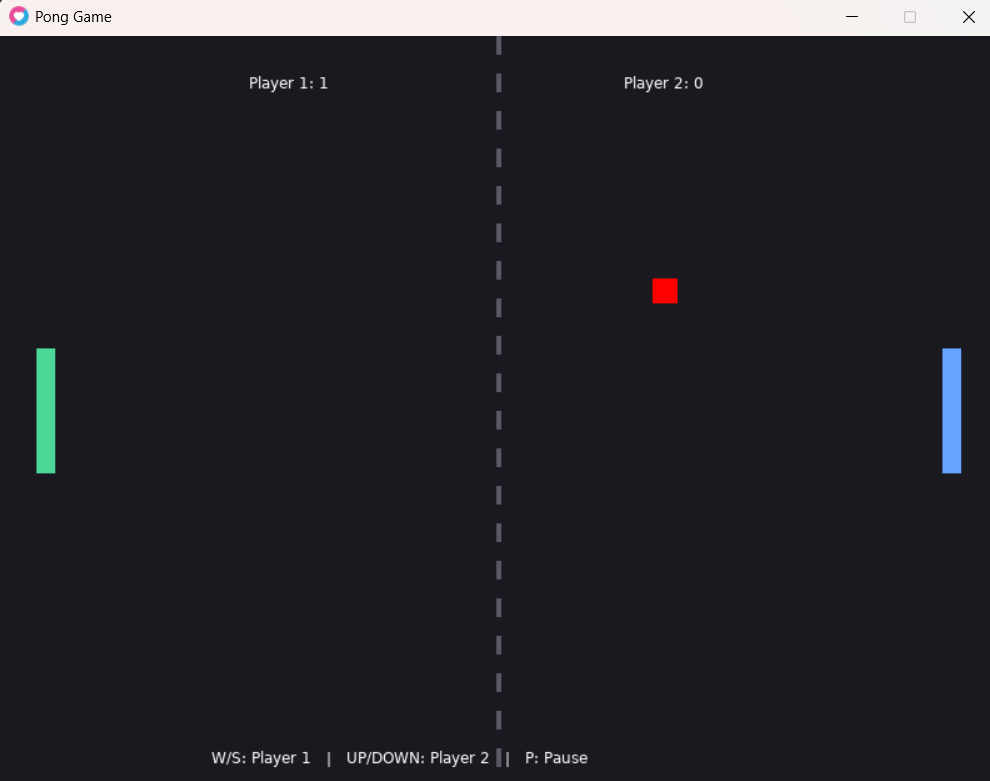

# Pong Game – LÖVE2D

## Student Information

- **Full Name:** [shuroq enab]

## Game Description

This project is a two-player Pong game developed using Lua and the LÖVE2D framework. Each player controls a paddle to bounce the ball back toward the opponent. Players earn points when the opponent misses the ball. The game uses delta time for consistent movement and AABB collision detection for ball and paddle interactions. The first player to reach five points wins the match.

## Controls

| Key        | Action                |
| ---------- | --------------------- |
| W          | Move Player 1 up      |
| S          | Move Player 1 down    |
| Up Arrow   | Move Player 2 up      |
| Down Arrow | Move Player 2 down    |
| P          | Pause / Resume        |
| R          | Restart after winning |
| Esc        | Exit the game         |

## My Own Changes

I added four extra features to the basic Pong game:

1. **Different Colors:** Player 1 has a green paddle, Player 2 has a blue paddle, and the ball is red.
2. **Score System:** Players receive points when their opponent misses the ball.
3. **Pause / Resume:** Pressing P pauses or resumes the game.
4. **Winning Screen:** The first player to reach five points wins, and pressing R starts a new match.

## Screenshot

## Demo Video

[Watch the Pong Game Demo](demo/pong-demo.mp4)

## Technologies

- Lua
- LÖVE2D
- Git and GitHub
